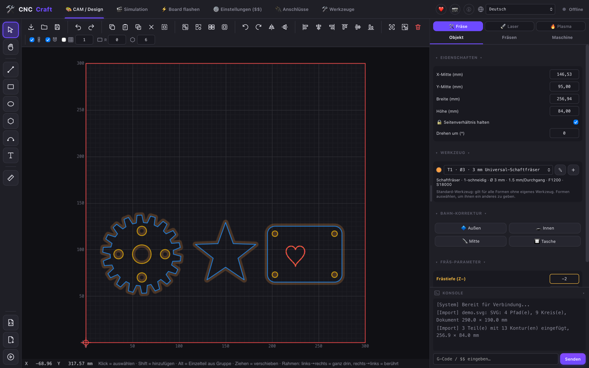
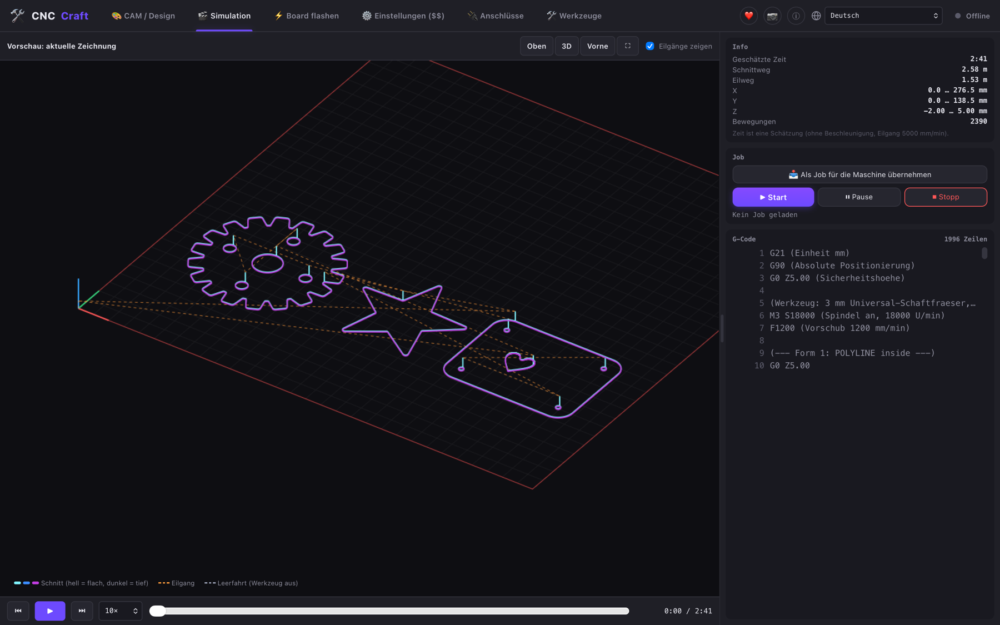
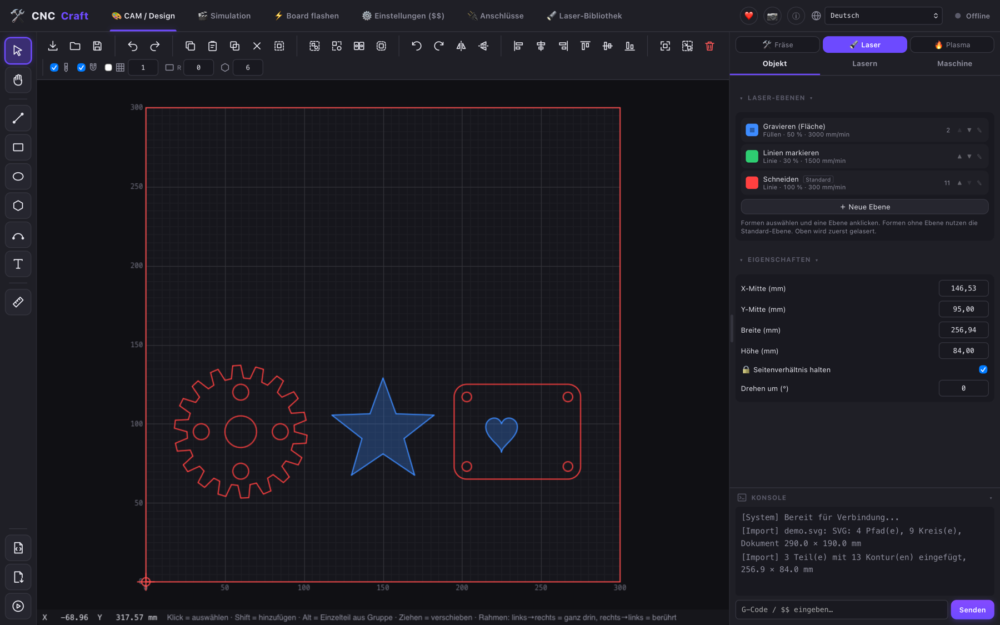
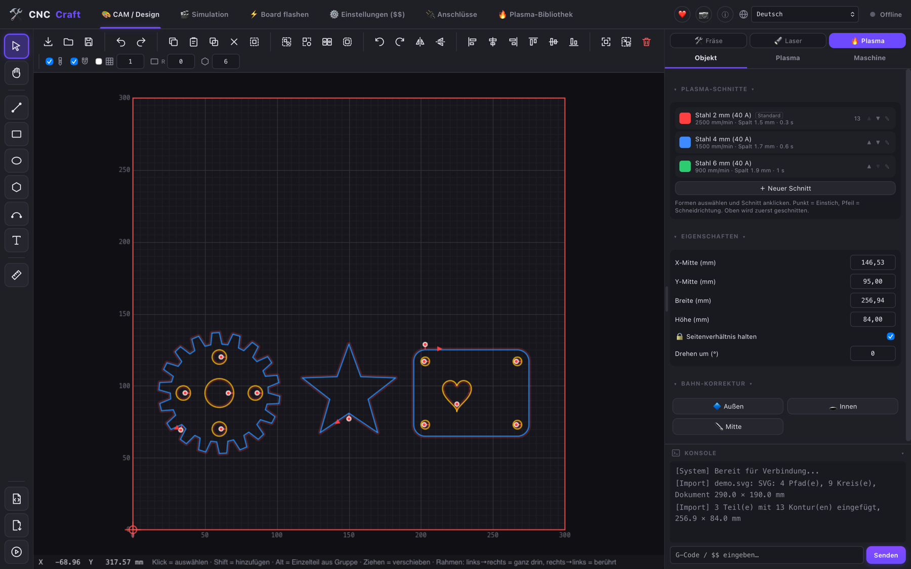
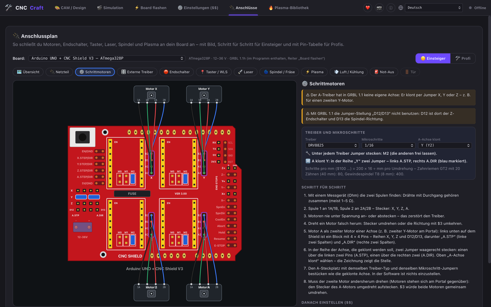
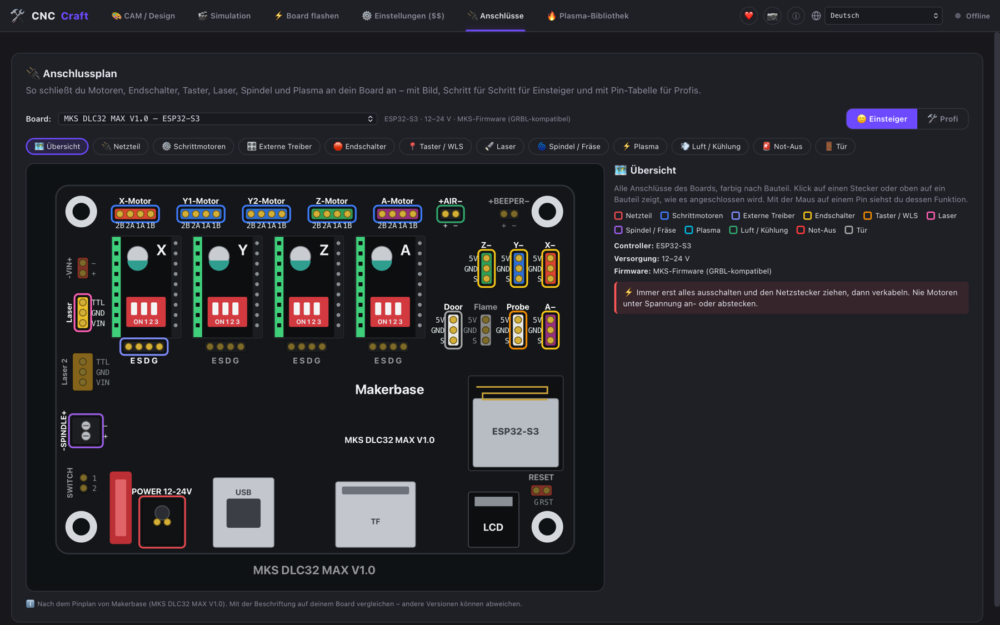
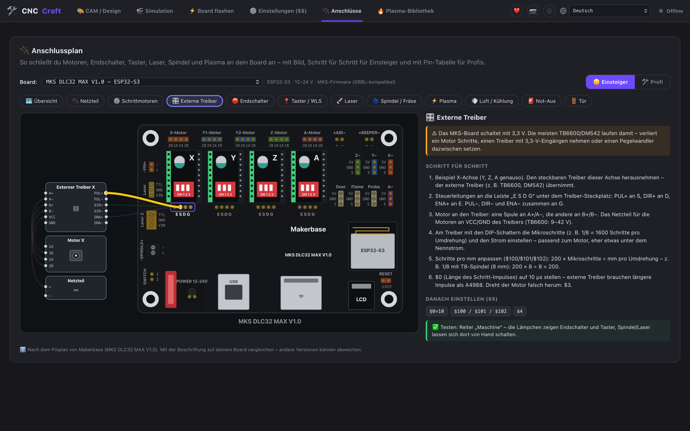

# CNC Craft

🇬🇧 [English](README.md) · 🇩🇪 **Deutsch** · 🌐 **Webseite: [andys-3d-world.github.io/cnc-craft/de](https://andys-3d-world.github.io/cnc-craft/de/)**

Open-Source-Programm für **Laser, CNC-Fräse und Plasma** – Design, CAM und Maschinensteuerung in einem
(kein Wechseln mehr zwischen drei Programmen). Läuft auf macOS, Windows und Linux.

**Status: 0.3.2 Beta** – bitte testen, Fehler melden, und Maschinen zuerst ohne Werkstück / mit wenig Leistung ausprobieren.



## Was es kann

- Zeichnen, Import (SVG, DXF, PDF, PLT, Bilder, 3D-Modelle als STL, 3MF und STEP), Fräsbahnen mit Werkzeug-Bibliothek wie in Estlcam
- Laser-Ebenen wie in LightBurn (Gravieren, Linie, Schneiden mit Freischnitt), Plasma mit Schnittspalt, Anfahrbahn,
  Blechhöhe abtasten und Höhenregelung (THC)
- Restplatten-Verwaltung: verbrauchte Fläche wird gemerkt, Teile darauf werden nicht geschnitten
- 3D-Simulation mit Zeit, Weg und G-Code vor jedem Job
- Bibliotheken für Fräswerkzeuge, Laser-Ebenen und Plasma-Schnitte – mit Export/Import und Komplett-Sicherung;
  alle Einstellungen werden zusätzlich als Datei gesichert und überstehen Updates
- Steuerungen: GRBL / grblHAL / FluidNC / Grbl_ESP32 (USB und WLAN), Marlin, Ruida (CO₂), K40 (M2 Nano)
- Mehrere Maschinen gleichzeitig verbinden (z. B. Laser per USB und Fräse per WLAN): auswählen, Jobs laufen im
  Hintergrund weiter, „Alle stoppen“ für alle
- Spindel, Laser-Testschuss, Overrides 10–200 %, Eingangs-Lämpchen für Endschalter und Taster
- Kamera (USB-Webcam oder IP-Kamera): zuschauen, Foto/Video, entzerrtes Kamerabild unter der Zeichnung, Ausrichten mit 4 Laser-Kreuzen
- Netzwerk-Suche für Maschinen im WLAN/LAN (FluidNC, grblHAL, MKS DLC32 …)
- WLAN einrichten direkt aus der App – Netze in der Nähe auswählen, Sonderzeichen im Passwort, Erst-Einrichtung über das WLAN des Boards (inkl. MKS DLC32 MAX), eigener Name je Maschine
- Maschinen-Einstellungen ($$) verständlich erklärt, mit Sichern/Laden und Werkseinstellung – bei grblHAL mit den
  Beschreibungen direkt vom Board
- Board flashen (ESP32/ESP32-S3 inkl. .elf und grblHAL-Web-Builder-.zip, Arduino UNO/Nano mit mitgeliefertem GRBL 1.1h)
- Anschlusspläne für CNC Shield V3, MKS DLC32 V2.1 und MKS DLC32 MAX – wie die echten Boards gezeichnet, mit Jumpern /
  DIP-Schaltern für Mikroschritte, Motor A als zweitem Motor, externen Treibern (TB6600, DM542); Maus aufs Kabel hebt es hervor
- Update direkt aus der App („Jetzt aktualisieren“ im ⓘ-Fenster, signiert)
- 7 Sprachen: Deutsch, English, Français, Español, Italiano, Nederlands, Polski

## Bilder

| | |
|---|---|
|  <br> **Simulation** – Fräsbahnen in 3D, Zeit und G-Code |  <br> **Laser** – Ebenen: Gravieren (Fläche) und Schneiden |
|  <br> **Plasma** – Schnitte, Einstichpunkte und Anfahrbahnen |  <br> **Anschlussplan** – Jumper für Mikroschritte und zweiten Y-Motor |
|  <br> **MKS DLC32 MAX** – wie das echte Board |  <br> **Externe Treiber** – TB6600 / DM542, Maus aufs Kabel hebt es hervor |

Download (Windows-Version signiert über die [SignPath Foundation](https://signpath.org), siehe [Code Signing Policy](#code-signing-policy)): [Releases](https://github.com/Andys-3D-World/cnc-craft/releases) · Was sich geändert hat: [CHANGELOG.md](CHANGELOG.md)

## ⚠️ Sicherheit und Haftung

CNC-Maschinen, Laser und Plasmaschneider können schwere Verletzungen, Brände und Sachschäden verursachen.

- **Laser nie unbeaufsichtigt laufen lassen**, passende Laserschutzbrille tragen, Feuerlöscher griffbereit, gut lüften
  (Rauch von Kunststoffen kann giftig sein – PVC/Vinyl niemals lasern).
- Jede Maschine braucht einen **echten Not-Aus-Schalter** (Hardware). Die Stopp-Knöpfe im Programm ersetzen ihn nicht –
  eine abbrechende USB- oder WLAN-Verbindung kann jederzeit passieren.
- Neue Jobs zuerst **ohne Werkstück bzw. mit wenig Leistung** testen, Simulation und Rahmen-Fahrt nutzen.
- Einstellungen der Steuerung (Schritte/mm, Endschalter, Leistung) vor dem ersten Job prüfen.

CNC Craft ist eine Beta-Version und wird **ohne jede Gewährleistung** bereitgestellt, so weit es das Gesetz erlaubt
(siehe Abschnitte 15 und 16 der [GPLv3](LICENSE)). Die Verantwortung für den sicheren Betrieb der Maschine liegt beim
Betreiber.

## ❤️ CNC Craft unterstützen

CNC Craft ist kostenlos und bleibt es auch. Wenn dir das Programm hilft und du die Weiterentwicklung
unterstützen möchtest, freue ich mich über einen Kaffee:

[](https://ko-fi.com/andys3dworld)
[](https://github.com/sponsors/Andys-3D-World)

Genauso hilfreich und kostenlos: ⭐ Stern auf GitHub vergeben, Fehler melden ([Issues](https://github.com/Andys-3D-World/cnc-craft/issues))
und das Programm weitererzählen – z. B. über meine Videos auf YouTube, TikTok und Instagram („Andys 3D World“).

Unterstützung ist freiwillig – alle Funktionen sind für alle frei, es gibt keine Bezahl-Version.

## 🤝 Mitwirken

Jede Hilfe ist willkommen: Fehler melden und Ideen vorschlagen unter [Issues](https://github.com/Andys-3D-World/cnc-craft/issues)
oder [Discussions](https://github.com/Andys-3D-World/cnc-craft/discussions),
Übersetzungen verbessern (`src/i18n/lang/*.json`) oder neue Boards und Maschinen testen.

**Mit KI entwickelt:** CNC Craft wird von Andreas Piaszek (Andys 3D World) entwickelt. Beim Programmieren hilft das
KI-Werkzeug [Claude Code](https://claude.com/claude-code) von Anthropic – ohne diese Hilfe wäre CNC Craft nicht so weit.
Ideen, Planung und Entscheidungen kommen von mir. Jede Änderung wird von mir geprüft und an echten Maschinen und Boards
getestet. Commits, an denen die KI mitgeschrieben hat, sind mit „Co-Authored-By: Claude“ gekennzeichnet.

## Selbst bauen

Voraussetzungen: [Node.js](https://nodejs.org) (LTS), [Rust](https://rustup.rs) und die
[Tauri-Voraussetzungen](https://v2.tauri.app/start/prerequisites/) für dein System.

```bash
npm install            # einmalig
npm run tauri dev      # zum Entwickeln (Fenster mit Live-Neuladen)
npm run tauri build    # Installationsdatei bauen
```

Die fertigen Dateien liegen danach in `src-tauri/target/release/bundle/`
(macOS: `dmg/` und `macos/`, Windows: `nsis/` und `msi/`, Linux: `appimage/`, `deb/`, `rpm/`).

Installationsdateien für alle Systeme baut die GitHub-Action `.github/workflows/release.yml`
(Reiter „Actions“ → „Release bauen“ → „Run workflow“). Das Ergebnis landet als Entwurf unter „Releases“.

## Lizenz

CNC Craft ist freie Software: Du darfst es benutzen, weitergeben und verändern – unter den Bedingungen der
**GNU General Public License Version 3** (oder einer späteren Version), siehe [LICENSE](LICENSE).
Copyright © 2026 Andys 3D World.

Mitgelieferte Teile anderer Projekte (alle Open Source) stehen in [THIRD_PARTY_NOTICES.md](THIRD_PARTY_NOTICES.md):
die GRBL-Firmware (`src-tauri/firmware/`, GPLv3) und der STEP-Import mit
[occt-import-js](https://github.com/kovacsv/occt-import-js) und [Open CASCADE Technology](https://www.opencascade.com)
(`public/occt/`, LGPL 2.1), dazu 26 freie Schriften für das Text-Werkzeug (`public/fonts/`, SIL Open Font License 1.1
oder Apache 2.0, Lizenztexte neben den Dateien). Das Text-Werkzeug kann außerdem jede auf dem Rechner installierte Schrift nutzen.

Genannte Produkt- und Firmennamen (z. B. LightBurn, Estlcam, OpenBuilds, MKS, xTool, Ruida) gehören ihren
jeweiligen Inhabern und dienen nur zur Beschreibung, mit welchen Programmen und Maschinen CNC Craft vergleichbar
bzw. kompatibel ist. CNC Craft ist mit keinem dieser Hersteller verbunden.

## Datenschutz

CNC Craft sammelt keine Daten und hat keine Telemetrie. Es gibt nur diese Netzwerk-Verbindungen:

- **Update-Prüfung:** einmal am Tag eine Anfrage an die GitHub-API (`api.github.com`), welche Version die neueste
  ist. Dabei werden keine Daten über dich, deine Zeichnungen oder Maschinen gesendet – GitHub sieht nur die
  üblichen Verbindungsdaten (IP-Adresse). Abschalten: ⓘ oben rechts → „Automatisch nach Updates suchen“.
- **Deine eigenen Geräte im Heimnetz:** Maschinen (Telnet/WLAN), Kameras und die 📡-Suche verbinden sich nur mit
  Geräten in deinem lokalen Netzwerk und nur, wenn du das auslöst.
- **Links** (Firmware-Downloads, Hilfe) öffnen sich nur auf Klick in deinem Browser.

Einstellungen und Bibliotheken bleiben auf deinem Rechner (App-Datenordner, siehe ⓘ).

Ausführlich (Deutsch/English): [PRIVACY.md](PRIVACY.md)

## Code Signing Policy

Die Windows-Installationsdateien werden signiert.

*Free code signing provided by [SignPath.io](https://about.signpath.io), certificate by
[SignPath Foundation](https://signpath.org).*

- **Committers and reviewers:** [Andys-3D-World](https://github.com/Andys-3D-World) (Andreas Piaszek)
- **Approvers:** [Andys-3D-World](https://github.com/Andys-3D-World) (Andreas Piaszek)
- Signiert werden nur Programme, die automatisch aus dem Quellcode dieses Repositorys gebaut wurden
  (GitHub Actions, `.github/workflows/release.yml`). Jede Veröffentlichung wird vorher von Hand freigegeben.
- Alle Beteiligten nutzen Zwei-Faktor-Anmeldung bei GitHub und SignPath.

**Privacy policy (English):** This program will not transfer any information to other networked systems unless
specifically requested by the user or the person installing or operating it. The only automatic connection is a
daily update check against the public GitHub API, which can be turned off in the app (ⓘ → “Automatically check
for updates”). Connections to machines, cameras and the 📡 network search only go to devices in the user's local
network and only when the user starts them.
