# CNC Craft

🇬🇧 **English** · 🇩🇪 [Deutsch](README.de.md) · 🌐 **Website: [andys-3d-world.github.io/cnc-craft](https://andys-3d-world.github.io/cnc-craft/)**

Free, open-source software for **laser engravers, CNC routers and plasma cutters** – design, CAM and machine control
in one app, so you no longer switch between three programs. Runs on macOS, Windows and Linux.

**Status: 0.4.5 Beta** – please test, report bugs, and try machines without a workpiece / at low power first.

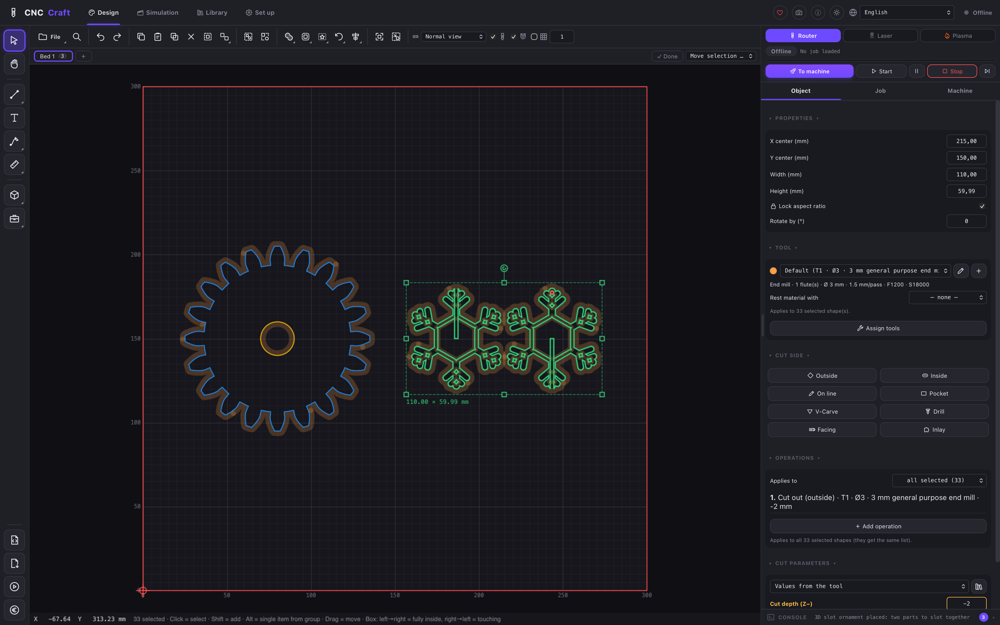

## Features

**Design & import**
- Drawing tools with Bézier curves and node editing, text with 26+ fonts, single-line fonts and all system fonts,
  dimensions and constraints, booleans (weld, score), patterns, duplicate / “fill the bed”, nesting (also into offcuts)
- Shape library, QR codes, serial numbers and variable text, several beds per project (like build plates in a slicer)
- **Generators:** boxes with finger joints (20 types, with 3D view), jigsaw puzzles, decoration ornaments for every
  season (Christmas, Easter, Halloween, spring, summer, autumn, love – also with two layers and a landscape), 3D slot
  ornaments, word tile ornaments, shadow boxes / light arches with LED cut-outs and stand, letter
  toppers, birth letters (name, date and birth data with own pictures), birdhouses, mandalas, one-piece names with
  symbols, gears (spur gears, racks, belt pulleys, chain sprockets – with bore and keyway), living hinges, rulers and
  clock faces, wood joints (finger joints, dovetails), slot-together shelves, vent grilles,
  labels, keychains and three-layer photo frames
- Import SVG, DXF, PDF, PLT and images (trace outlines or centerlines), 3D models as STL, 3MF, OBJ and STEP – big files
  are read in background threads
- 3D view of the finished parts, node graph for reusable workflows

**Router (CAM)**
- Tool library like in Estlcam (end mills, ball, V-bits, chamfer, drills, thread mills …), Fusion 360 tool import,
  material database with cutting data, tool wear compensation, tool coating
- Outside / inside / on-line, pockets, adaptive clearing, finishing pass, ramp entry, holding tabs, dogbones,
  drilling, chamfers, facing and spoilboard surfacing, V-carve & inlay, rest machining, thread milling
  (internal/external), several operations per shape
- 3D milling from 3D models and reliefs from images or text (roughing and finishing), automatic split into cut-outs, holes and pockets,
  face stock on both sides
- **Rotary axis for milling** (along X or Y): engrave, contours, pockets, V-carve and drilling on round parts;
  3D models all around (4th axis simultaneous) or from several sides (indexing)
- Tool change with tool length measurement, re-measure during long jobs, probing, height map, drilling cycles
  G81–G89 on GRBL, slower feed in tight curves

**Laser**
- Layers like in LightBurn (fill, line, cut, fill + line) with cut order and lead-ins, holding tabs
- Image engraving with 14 styles, tone curve, auto enhance and before/after preview – adjusted on the graphics card
- Material view with 29 materials (wood, plywood, MDF, acrylic, laminate, raw and anodized aluminium, brass, steel,
  stainless, slate …), material presets incl. fibre laser, test grid,
  your own presets, lower power in corners for lasers without M4
- Rotary for tumblers and bottles, camera alignment and material detection

**Plasma**
- Kerf compensation, lead-ins, pierce points, material presets (40 A / 60 A air plasma), sheet height probing,
  torch height control (THC)
- Shortest cut order, rapids go around parts already cut, remnant sheet management (used areas are not cut again)

**Simulation**
- 3D simulation on the graphics card – smooth even with millions of moves – with time, distance, cost calculator
- **Live material removal:** watch the stock being milled away with cutter, collet and spindle, laser burn marks
  and cuts, plasma kerf – also on the rotary axis, where the part turns; works live during the real job too
- Collision warnings: rapid moves into material, shank or collet touching the stock – with the G-code line
- G-code editor (also while a job runs), click a toolpath to jump to its line, resume a job from any line

**Machine control**
- GRBL / grblHAL / FluidNC / Grbl_ESP32 (USB and Wi-Fi), Marlin, Ruida (CO₂), K40 (M2 Nano)
- Several machines at once (e.g. laser via USB and router via Wi-Fi), jobs keep running in the background,
  “Stop all” stops every machine
- Jogging limited to the bed, spindle, laser test fire, overrides 10–200 %, input indicators for limit switches and probes
- Spindle inverter (VFD) over Modbus RTU/TCP, smart workshop (dust extractor, compressor … switch with the job),
  the computer stays awake during a job
- Camera (USB webcam or IP camera): watch, photo/video, camera image under the drawing

**Setup help**
- Network search for machines on Wi-Fi/LAN, Wi-Fi setup right from the app (incl. the board's own Wi-Fi)
- Machine settings ($$) explained in plain words, with backup/restore and factory reset
- Flash boards (ESP32/ESP32-S3 incl. grblHAL Web Builder .zip, Arduino UNO/Nano with GRBL 1.1h)
- **Wiring diagrams for 18 boards** – Arduino CNC Shield V3, Nano + CNC Shield V4, MKS DLC32 V2.1 and MAX,
  PiBot V4.96 Pro and V5.88 Ultra, 6 Pack and 6 Pack Integrated, Jackpot and Jackpot3, BTT SKR Pro and Rodent,
  OpenBuilds BlackBox 4X and X32, Sienci SuperLongBoard, Arduino Mega + RAMPS, Ruida RDC6445G and RDC6442G –
  drawn like the real boards, with external drivers,
  inductive NPN/PNP sensors, rotary, displays and VFD wiring

**Everything else**
- Ask to save before closing, autosave and crash recovery, report a bug from inside the app
- Libraries for tools, laser layers and plasma cuts with export/import, full backup and workshop sync between two computers
- All settings are also saved to a file and survive updates; update right from the app (signed)
- 7 languages: Deutsch, English, Français, Español, Italiano, Nederlands, Polski
- Dark and light mode (☀️ / 🌙 at the top right)

## Installation

Download the file for your system from the [latest release](https://github.com/Andys-3D-World/cnc-craft/releases/latest).

- **macOS:** open the `.dmg` and drag CNC Craft into *Applications*. On the first start macOS says “not verified”:
  System Settings → Privacy & Security → “Open Anyway”.
- **Windows:** run `…_x64-setup.exe` (SmartScreen: “More info” → “Run anyway”).
- **Linux:** see below.

### Linux

**AppImage (every distribution, recommended):** one file, updates itself from the app (ⓘ → “Update now”).
Open a terminal (`Ctrl + Alt + T`) and run these lines – they move the file out of *Downloads*, add CNC Craft
to the app menu and give it an icon:

```bash
mkdir -p ~/Applications ~/.local/share/applications ~/.local/share/icons
mv ~/Downloads/CNC.Craft_*_amd64.AppImage ~/Applications/CNC-Craft.AppImage
chmod +x ~/Applications/CNC-Craft.AppImage
curl -L -o ~/.local/share/icons/cnc-craft.png https://raw.githubusercontent.com/Andys-3D-World/cnc-craft/main/src-tauri/icons/128x128.png
cat > ~/.local/share/applications/cnc-craft.desktop <<EOT
[Desktop Entry]
Type=Application
Name=CNC Craft
Comment=Laser, CNC router and plasma – design, CAM and machine control
Exec=$HOME/Applications/CNC-Craft.AppImage
Icon=$HOME/.local/share/icons/cnc-craft.png
Categories=Graphics;Engineering;
Terminal=false
EOT
```

CNC Craft is now in the app menu (KDE, GNOME …). If the AppImage does not start, install FUSE 2
(Debian/Ubuntu: `sudo apt install libfuse2`, Arch/CachyOS: `sudo pacman -S fuse2`).
To remove it: delete `~/Applications/CNC-Craft.AppImage` and `~/.local/share/applications/cnc-craft.desktop`.

**Debian / Ubuntu / Mint (.deb):** `sudo apt install ~/Downloads/CNC.Craft_*_amd64.deb`
**Fedora (.rpm):** `sudo dnf install ~/Downloads/CNC.Craft-*.x86_64.rpm` · **openSUSE:** `sudo zypper install ~/Downloads/CNC.Craft-*.x86_64.rpm`
For a new version, download the new file and install it the same way.

**USB connection (serial port):** your user must be allowed to use serial ports – once, then log out and in again:

```bash
sudo usermod -aG dialout $USER     # Debian, Ubuntu, Mint, Fedora
sudo usermod -aG uucp $USER        # Arch, CachyOS, Manjaro
```

## Screenshots

| | |
|---|---|
| 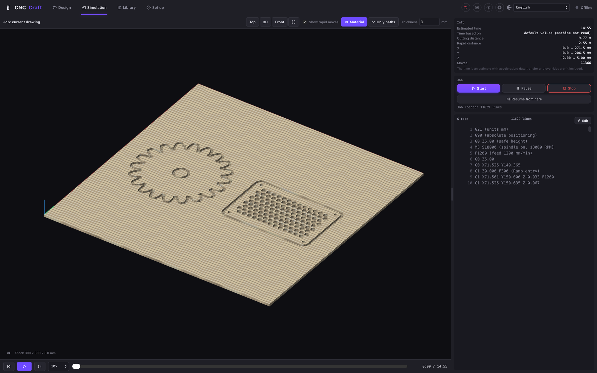 <br> **Simulation** – toolpaths in 3D, time and G-code | 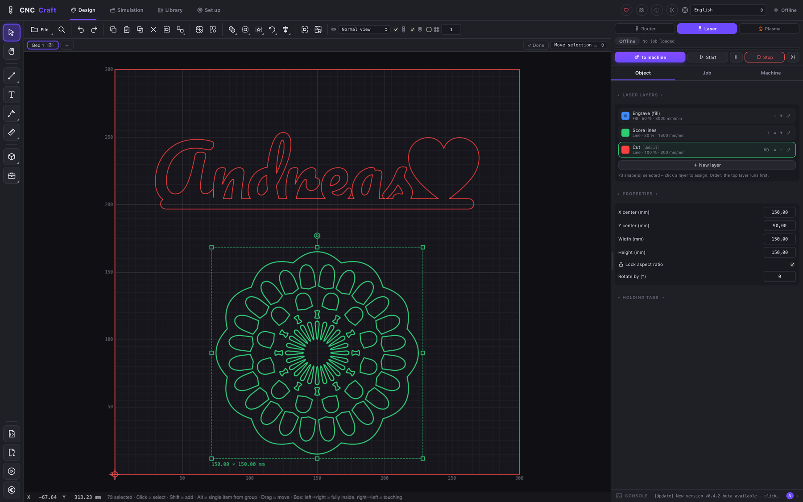 <br> **Laser** – layers: engrave (fill) and cut |
| 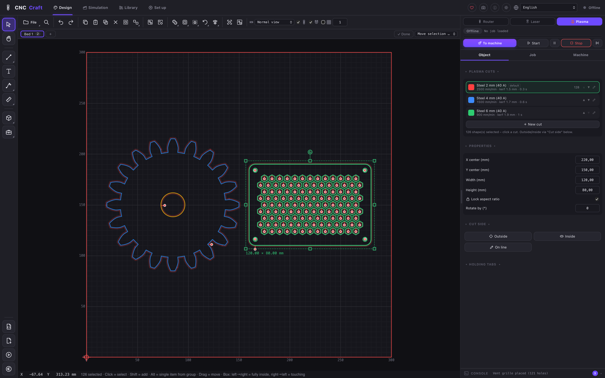 <br> **Plasma** – cuts, pierce points and lead-ins | 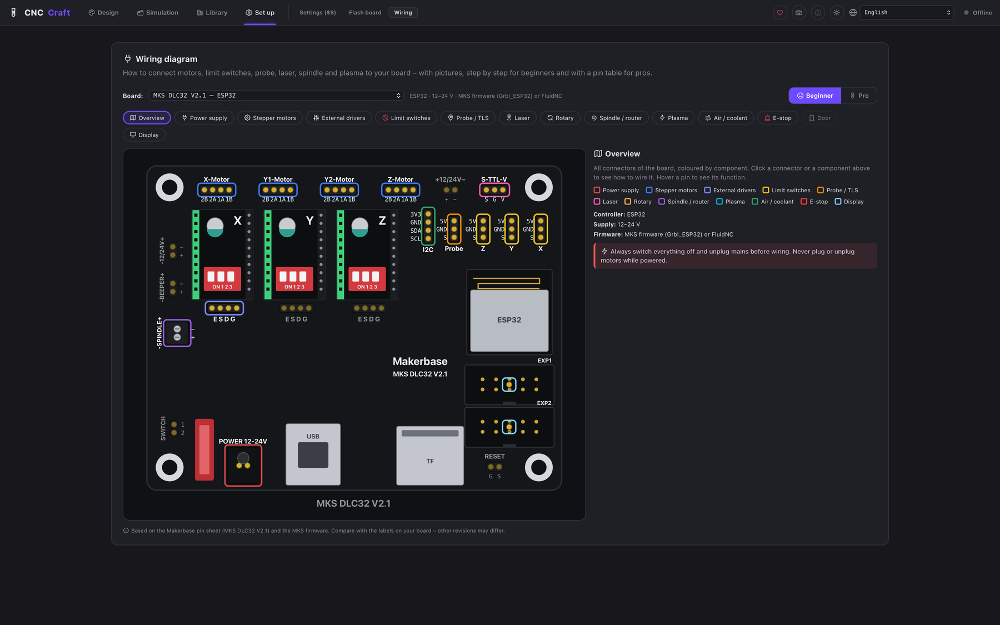 <br> **Wiring diagram** – jumpers for microsteps and a second Y motor |
| 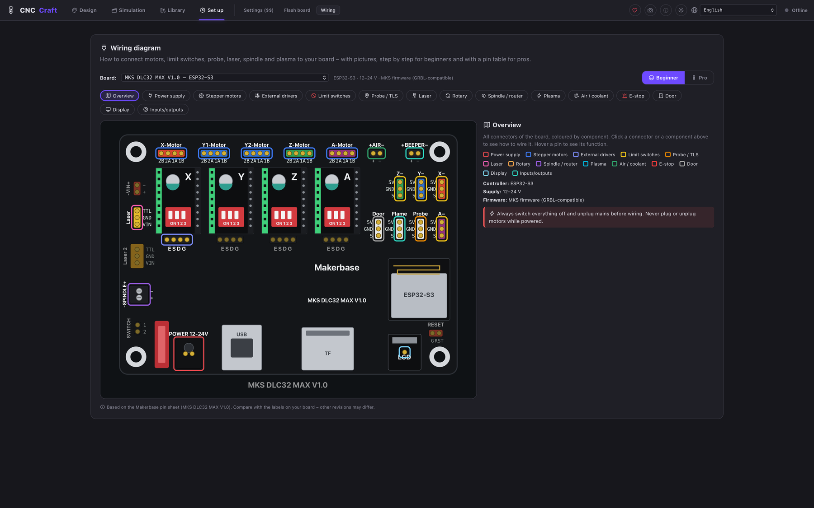 <br> **MKS DLC32 MAX** – drawn like the real board | 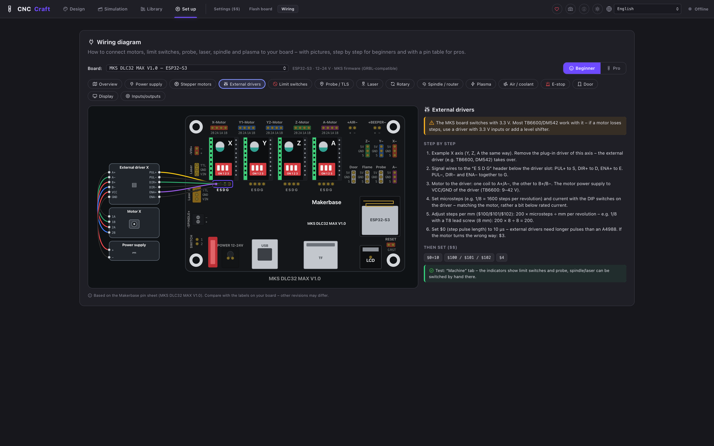 <br> **External drivers** – TB6600 / DM542, hover a wire to highlight it |
| 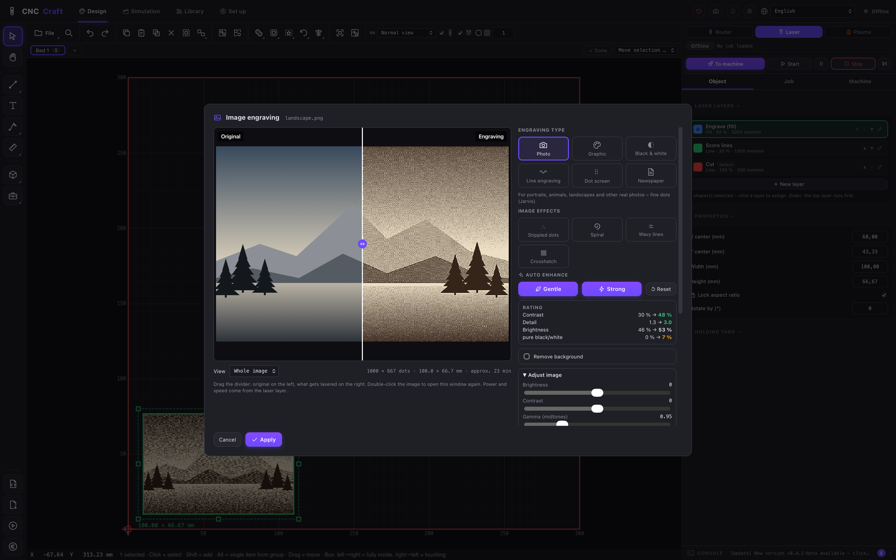 <br> **Image engraving** – photos with before/after preview | 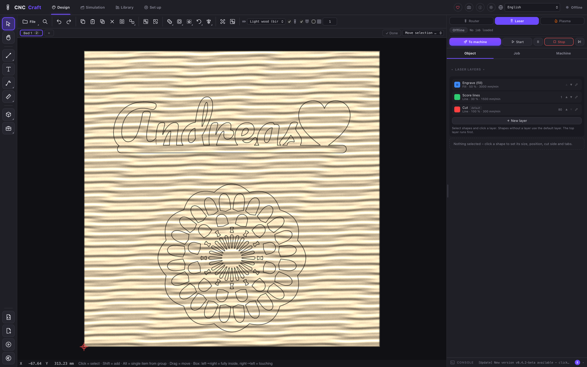 <br> **Material view** – see the result on wood, slate or acrylic |
| 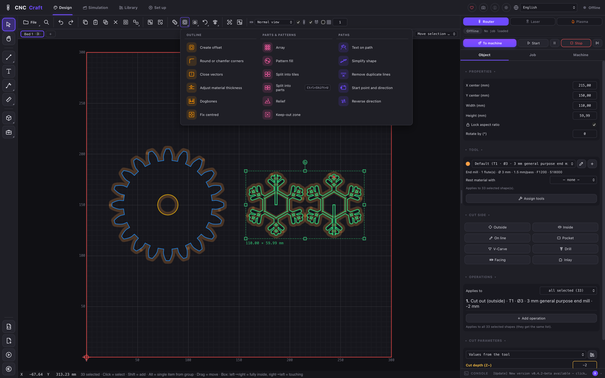 <br> **Shape tools** – booleans, dimensions, Bézier curves | 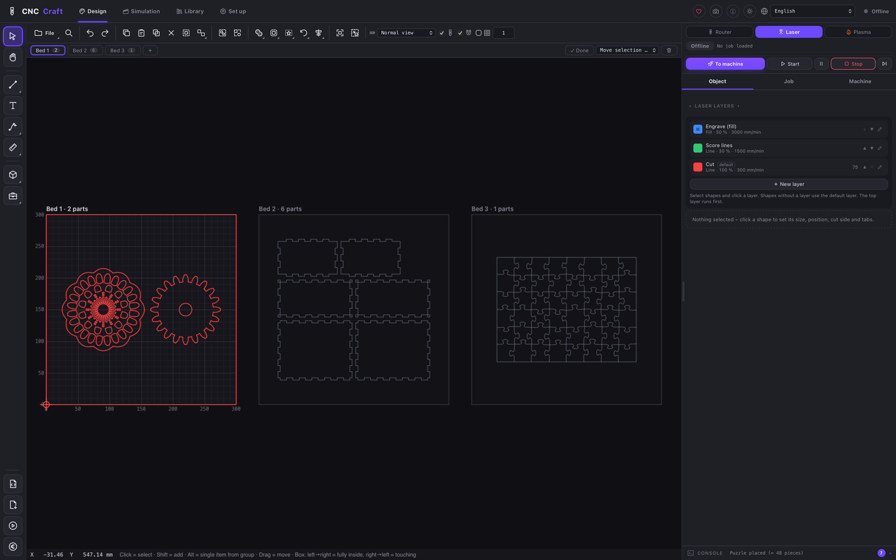 <br> **Several beds** – one project, several plates |

Download (Windows version signed via the [SignPath Foundation](https://signpath.org), see [Code Signing Policy](#code-signing-policy)): [Releases](https://github.com/Andys-3D-World/cnc-craft/releases) · What changed: [CHANGELOG.md](CHANGELOG.md)

## ⚠️ Safety and liability

CNC machines, lasers and plasma cutters can cause serious injuries, fires and property damage.

- **Never leave a laser running unattended**, wear suitable laser safety glasses, keep a fire extinguisher at hand,
  ventilate well (fumes from plastics can be toxic – never laser PVC/vinyl).
- Every machine needs a **real emergency stop switch** (hardware). The stop buttons in the software do not replace it –
  a USB or Wi-Fi connection can drop at any time.
- Test new jobs **without a workpiece or at low power** first, use the simulation and the frame run.
- Check the controller settings (steps/mm, limit switches, power) before the first job.

CNC Craft is beta software and is provided **without any warranty**, to the extent permitted by law
(see sections 15 and 16 of the [GPLv3](LICENSE)). The operator is responsible for running the machine safely.

## ❤️ Support CNC Craft

CNC Craft is free and will stay free. If the software helps you and you'd like to support its development,
I'd be happy about a coffee:

[](https://ko-fi.com/andys3dworld)
[](https://github.com/sponsors/Andys-3D-World)

Just as helpful and free: give it a ⭐ on GitHub, report bugs ([Issues](https://github.com/Andys-3D-World/cnc-craft/issues))
and tell others about it – e.g. through my videos on YouTube, TikTok and Instagram (“Andys 3D World”).

Support is voluntary – all features are free for everyone, there is no paid version.

## 🤝 Contributing

Any help is welcome: report bugs and suggest ideas in [Issues](https://github.com/Andys-3D-World/cnc-craft/issues)
or [Discussions](https://github.com/Andys-3D-World/cnc-craft/discussions), improve translations
(`src/i18n/lang/*.json`) or test new boards and machines.

**Developed with AI:** CNC Craft is developed by Andreas Piaszek (Andys 3D World). The AI tool
[Claude Code](https://claude.com/claude-code) by Anthropic helps with the programming – CNC Craft wouldn't be this far
without it. Ideas, planning and decisions are mine. Every change is reviewed by me. What has been tested on a real machine or
board, and what hasn't yet, is stated for each change in the [changelog](CHANGELOG.md) and the release notes.
Commits co-written by the AI are marked with “Co-Authored-By: Claude”.

## Building from source

Requirements: [Node.js](https://nodejs.org) (LTS), [Rust](https://rustup.rs) and the
[Tauri prerequisites](https://v2.tauri.app/start/prerequisites/) for your system.

```bash
npm install            # once
npm run tauri dev      # for development (window with live reload)
npm run tauri build    # build the installer
```

The finished files end up in `src-tauri/target/release/bundle/`
(macOS: `dmg/` and `macos/`, Windows: `nsis/` and `msi/`, Linux: `appimage/`, `deb/`, `rpm/`).

Installers for all systems are built by the GitHub Action `.github/workflows/release.yml`
(“Actions” tab → “Release bauen” → “Run workflow”). The result appears as a draft under “Releases”.

## License

CNC Craft is free software: you may use, share and modify it under the terms of the
**GNU General Public License version 3** (or any later version), see [LICENSE](LICENSE).
Copyright © 2026 Andys 3D World.

Bundled parts of other projects (all open source) are listed in [THIRD_PARTY_NOTICES.md](THIRD_PARTY_NOTICES.md):
the GRBL firmware (`src-tauri/firmware/`, GPLv3) and the STEP import with
[occt-import-js](https://github.com/kovacsv/occt-import-js) and [Open CASCADE Technology](https://www.opencascade.com)
(`public/occt/`, LGPL 2.1), plus 26 free fonts for the text tool (`public/fonts/`, SIL Open Font License 1.1 or
Apache 2.0, licence texts next to the files). The text tool can also use every font installed on your computer.

Product and company names mentioned (e.g. LightBurn, Estlcam, OpenBuilds, MKS, BIGTREETECH, Sienci Labs,
V1 Engineering, Keyestudio, Arduino, xTool, Ruida) belong to their
respective owners and are only used to describe which programs and machines CNC Craft is comparable or compatible
with. CNC Craft is not affiliated with any of these manufacturers.

## Privacy

CNC Craft collects no data and has no telemetry. These are the only network connections:

- **Update check:** once a day a request to the GitHub API (`api.github.com`) asking which version is the newest.
  No data about you, your drawings or machines is sent – GitHub only sees the usual connection data (IP address).
  Turn off: ⓘ top right → “Automatically check for updates”.
- **Your own devices on your home network:** machines (Telnet/Wi-Fi), cameras and the 📡 search only connect to
  devices on your local network and only when you start it.
- **Links** (firmware downloads, help) only open in your browser when you click them.

Settings and libraries stay on your computer (app data folder, see ⓘ).

Details (German/English): [PRIVACY.md](PRIVACY.md)

## Code Signing Policy

The Windows installers are signed.

*Free code signing provided by [SignPath.io](https://about.signpath.io), certificate by
[SignPath Foundation](https://signpath.org).*

- **Committers and reviewers:** [Andys-3D-World](https://github.com/Andys-3D-World) (Andreas Piaszek)
- **Approvers:** [Andys-3D-World](https://github.com/Andys-3D-World) (Andreas Piaszek)
- Only programs built automatically from the source code of this repository are signed
  (GitHub Actions, `.github/workflows/release.yml`). Every release is approved by hand beforehand.
- Everyone involved uses two-factor authentication on GitHub and SignPath.

**Privacy policy:** This program will not transfer any information to other networked systems unless
specifically requested by the user or the person installing or operating it. The only automatic connection is a
daily update check against the public GitHub API, which can be turned off in the app (ⓘ → “Automatically check
for updates”). Connections to machines, cameras and the 📡 network search only go to devices in the user's local
network and only when the user starts them.
