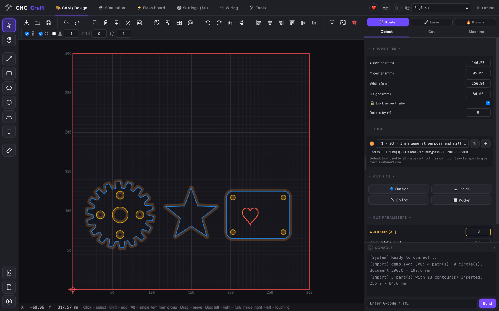
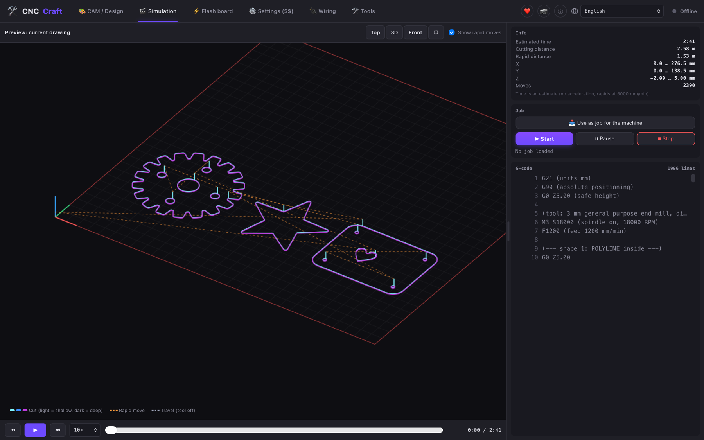
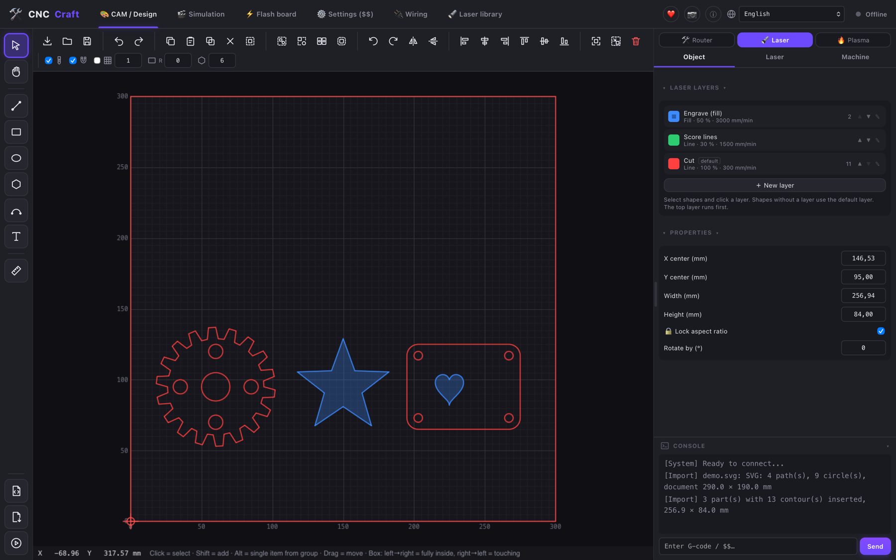
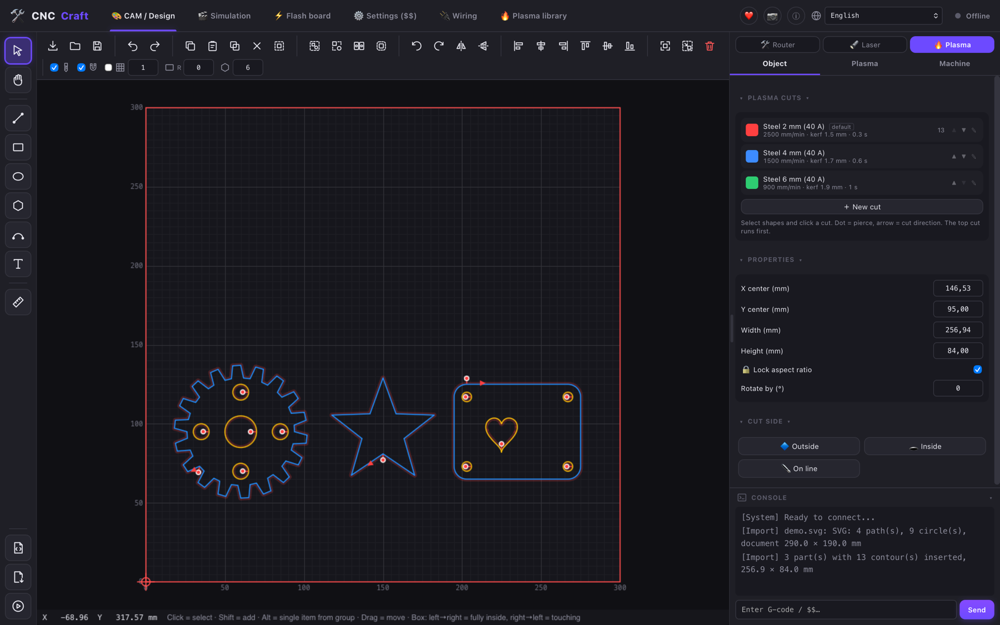
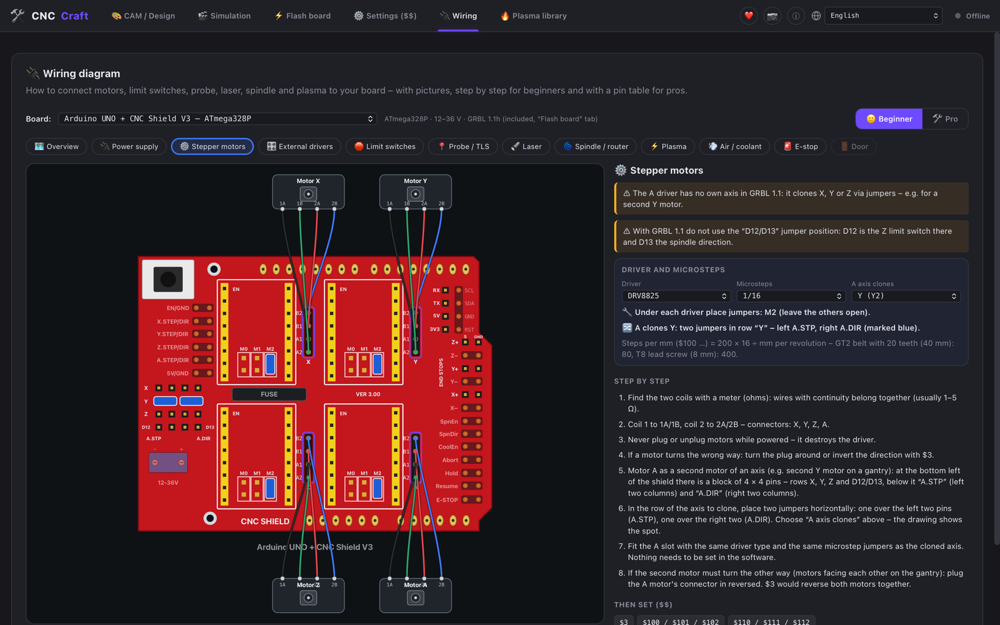
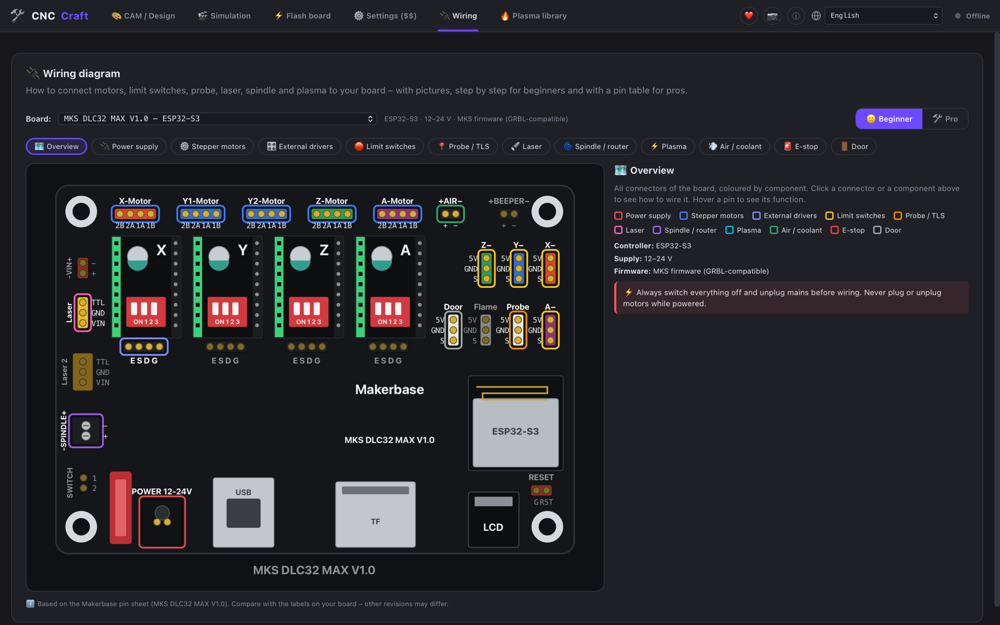
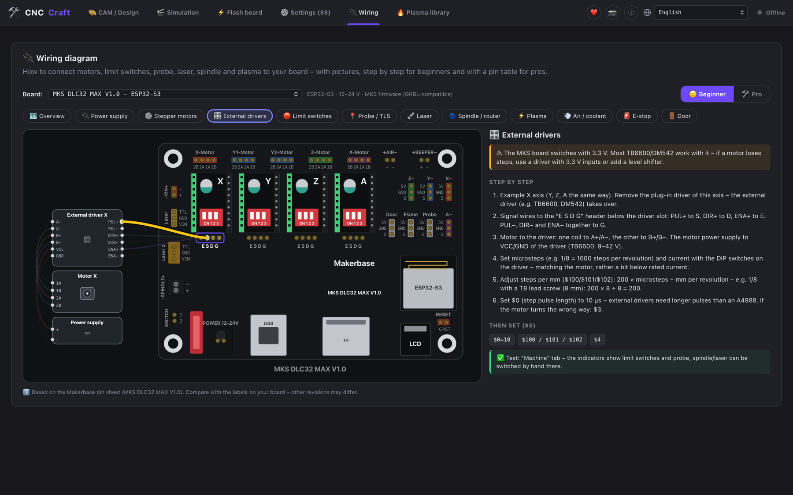

# CNC Craft

🇬🇧 **English** · 🇩🇪 [Deutsch](README.de.md) · 🌐 **Website: [andys-3d-world.github.io/cnc-craft](https://andys-3d-world.github.io/cnc-craft/)**

Free, open-source software for **laser engravers, CNC routers and plasma cutters** – design, CAM and machine control
in one app (think LightBurn + Estlcam + OpenBuilds combined). Runs on macOS, Windows and Linux.

**Status: 0.3.0 Beta** – please test, report bugs, and try machines without a workpiece / at low power first.



## Features

- Drawing and import (SVG, DXF, PDF, PLT, images, 3D models as STL, 3MF and STEP), router toolpaths with a tool library like in Estlcam
- Laser layers like in LightBurn (engrave/fill, line, cut with lead-in), plasma with kerf compensation, lead-ins,
  sheet height probing and torch height control (THC)
- Remnant sheet management: used areas are remembered, parts placed on them are not cut
- 3D simulation with time, distance and G-code before every job
- Libraries for router tools, laser layers and plasma cuts – with export/import and full backup;
  all settings are also saved to a file and survive updates
- Controllers: GRBL / grblHAL / FluidNC / Grbl_ESP32 (USB and Wi-Fi), Marlin, Ruida (CO₂), K40 (M2 Nano)
- Connect several machines at once (e.g. laser via USB and router via Wi-Fi): switch between them, jobs keep running in
  the background, “Stop all” stops every machine
- Spindle, laser test fire, overrides 10–200 %, input indicators for limit switches and probes
- Camera (USB webcam or IP camera): watch, photo/video, undistorted camera image under the drawing, alignment with 4 laser crosses
- Network search for machines on Wi-Fi/LAN (FluidNC, grblHAL, MKS DLC32 …)
- Set up Wi-Fi right from the app – pick nearby networks, special characters in passwords, first setup through the
  board's own Wi-Fi (incl. MKS DLC32 MAX), custom name per machine
- Machine settings ($$) explained in plain words, with backup/restore and factory reset – for grblHAL with the
  descriptions straight from the board
- Flash boards (ESP32/ESP32-S3 incl. .elf and grblHAL Web Builder .zip, Arduino UNO/Nano with bundled GRBL 1.1h)
- Wiring diagrams for CNC Shield V3, MKS DLC32 V2.1 and MKS DLC32 MAX – drawn like the real boards, with jumpers / DIP switches
  for microsteps, motor A as second motor, external drivers (TB6600, DM542); hover a wire to highlight it
- Update right from the app (“Update now” in the ⓘ window, signed)
- 7 languages: Deutsch, English, Français, Español, Italiano, Nederlands, Polski

## Screenshots

| | |
|---|---|
|  <br> **Simulation** – toolpaths in 3D, time and G-code |  <br> **Laser** – layers: engrave (fill) and cut |
|  <br> **Plasma** – cuts, pierce points and lead-ins |  <br> **Wiring diagram** – jumpers for microsteps and a second Y motor |
|  <br> **MKS DLC32 MAX** – drawn like the real board |  <br> **External drivers** – TB6600 / DM542, hover a wire to highlight it |

Download (Windows version signed via the [SignPath Foundation](https://signpath.org), see [Code Signing Policy](#code-signing-policy)): [Releases](https://github.com/Andys-3D-World/cnc-craft/releases) · What changed: [CHANGELOG.md](CHANGELOG.md) (German)

## ⚠️ Safety and liability

CNC machines, lasers and plasma cutters can cause serious injuries, fires and property damage.

- **Never leave a laser running unattended**, wear suitable laser safety glasses, keep a fire extinguisher at hand,
  ventilate well (fumes from plastics can be toxic – never laser PVC/vinyl).
- Every machine needs a **real emergency stop switch** (hardware). The stop buttons in the software do not replace it –
  a USB or Wi-Fi connection can drop at any time.
- Test new jobs **without a workpiece or at low power** first, use the simulation and the frame run.
- Check the controller settings (steps/mm, limit switches, power) before the first job.

CNC Craft is beta software and is provided **without any warranty**, to the extent permitted by law
(see sections 15 and 16 of the [GPLv3](LICENSE)). The operator is responsible for running the machine safely.

## ❤️ Support CNC Craft

CNC Craft is free and will stay free. If the software helps you and you'd like to support its development,
I'd be happy about a coffee:

[](https://ko-fi.com/andys3dworld)
[](https://github.com/sponsors/Andys-3D-World)

Just as helpful and free: give it a ⭐ on GitHub, report bugs ([Issues](https://github.com/Andys-3D-World/cnc-craft/issues))
and tell others about it – e.g. through my videos on YouTube, TikTok and Instagram (“Andys 3D World”).

Support is voluntary – all features are free for everyone, there is no paid version.

## 🤝 Contributing

Any help is welcome: report bugs and suggest ideas in [Issues](https://github.com/Andys-3D-World/cnc-craft/issues)
or [Discussions](https://github.com/Andys-3D-World/cnc-craft/discussions), improve translations
(`src/i18n/lang/*.json`) or test new boards and machines.

**Developed with AI:** CNC Craft is developed by Andreas Piaszek (Andys 3D World). The AI tool
[Claude Code](https://claude.com/claude-code) by Anthropic helps with the programming – CNC Craft wouldn't be this far
without it. Ideas, planning and decisions are mine. Every change is reviewed by me and tested on real machines and
boards. Commits co-written by the AI are marked with “Co-Authored-By: Claude”.

## Building from source

Requirements: [Node.js](https://nodejs.org) (LTS), [Rust](https://rustup.rs) and the
[Tauri prerequisites](https://v2.tauri.app/start/prerequisites/) for your system.

```bash
npm install            # once
npm run tauri dev      # for development (window with live reload)
npm run tauri build    # build the installer
```

The finished files end up in `src-tauri/target/release/bundle/`
(macOS: `dmg/` and `macos/`, Windows: `nsis/` and `msi/`, Linux: `appimage/`, `deb/`, `rpm/`).

Installers for all systems are built by the GitHub Action `.github/workflows/release.yml`
(“Actions” tab → “Release bauen” → “Run workflow”). The result appears as a draft under “Releases”.

## License

CNC Craft is free software: you may use, share and modify it under the terms of the
**GNU General Public License version 3** (or any later version), see [LICENSE](LICENSE).
Copyright © 2026 Andys 3D World.

Bundled parts of other projects (all open source) are listed in [THIRD_PARTY_NOTICES.md](THIRD_PARTY_NOTICES.md):
the GRBL firmware (`src-tauri/firmware/`, GPLv3) and the STEP import with
[occt-import-js](https://github.com/kovacsv/occt-import-js) and [Open CASCADE Technology](https://www.opencascade.com)
(`public/occt/`, LGPL 2.1).

Product and company names mentioned (e.g. LightBurn, Estlcam, OpenBuilds, MKS, xTool, Ruida) belong to their
respective owners and are only used to describe which programs and machines CNC Craft is comparable or compatible
with. CNC Craft is not affiliated with any of these manufacturers.

## Privacy

CNC Craft collects no data and has no telemetry. These are the only network connections:

- **Update check:** once a day a request to the GitHub API (`api.github.com`) asking which version is the newest.
  No data about you, your drawings or machines is sent – GitHub only sees the usual connection data (IP address).
  Turn off: ⓘ top right → “Automatically check for updates”.
- **Your own devices on your home network:** machines (Telnet/Wi-Fi), cameras and the 📡 search only connect to
  devices on your local network and only when you start it.
- **Links** (firmware downloads, help) only open in your browser when you click them.

Settings and libraries stay on your computer (app data folder, see ⓘ).

Details (German/English): [PRIVACY.md](PRIVACY.md)

## Code Signing Policy

The Windows installers are signed.

*Free code signing provided by [SignPath.io](https://about.signpath.io), certificate by
[SignPath Foundation](https://signpath.org).*

- **Committers and reviewers:** [Andys-3D-World](https://github.com/Andys-3D-World) (Andreas Piaszek)
- **Approvers:** [Andys-3D-World](https://github.com/Andys-3D-World) (Andreas Piaszek)
- Only programs built automatically from the source code of this repository are signed
  (GitHub Actions, `.github/workflows/release.yml`). Every release is approved by hand beforehand.
- Everyone involved uses two-factor authentication on GitHub and SignPath.

**Privacy policy:** This program will not transfer any information to other networked systems unless
specifically requested by the user or the person installing or operating it. The only automatic connection is a
daily update check against the public GitHub API, which can be turned off in the app (ⓘ → “Automatically check
for updates”). Connections to machines, cameras and the 📡 network search only go to devices in the user's local
network and only when the user starts them.
